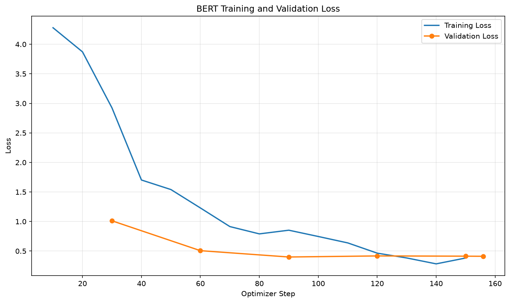
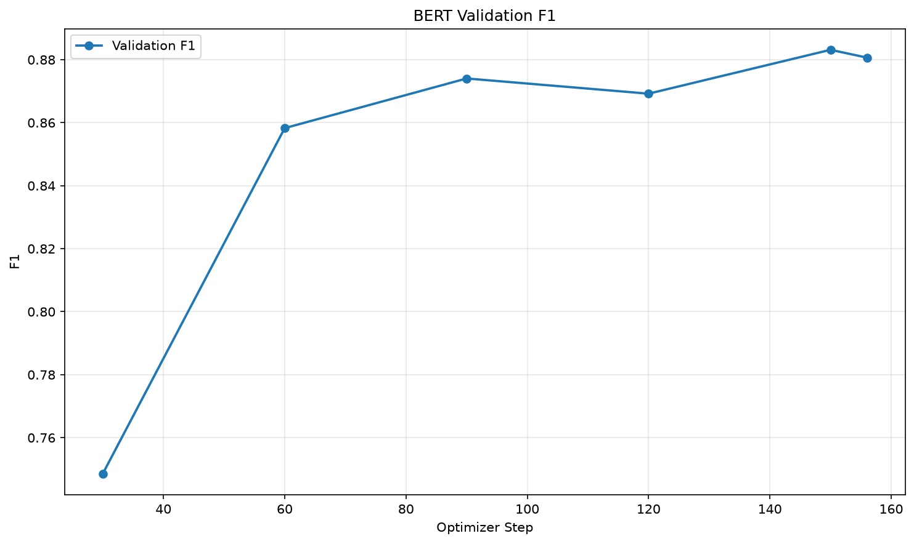

# 中文句子情緒分類

微調 `bert-base-chinese`，把一句中文分成 8 種情緒語調。原本課堂範例是二元分類（正面／負面評論），這份作業改成多元分類。

## 訓練資料來源

- [Datasets:Johnson8187/Chinese_Multi-Emotion_Dialogue_Dataset](https://huggingface.co/datasets/Johnson8187/Chinese_Multi-Emotion_Dialogue_Dataset)

從 `Files and versions` 下載 `data.csv`，共 4159 筆，欄位是 `text`、`emotion`。

## 基礎模型

- [google-bert/bert-base-chinese](https://huggingface.co/google-bert/bert-base-chinese)

## 安裝套件

Python 3.12，版本號由 `pip list` 查詢：

- torch (2.14.1)
- torchvision (0.29.1)
- torchaudio (2.11.0)
- transformers (5.17.0)
- datasets (5.0.1)
- evaluate (0.4.6)
- accelerate (1.15.0)
- scikit-learn (1.9.1)
- matplotlib (3.11.2)

訓練環境是 Apple M4（MPS），3 個 epoch 約 3 分鐘。程式也能在 Colab 的 NVIDIA GPU 上執行，有 CUDA 時會自動開啟 fp16。

## 說明

### 情緒類別

`emotion` 欄位是文字，微調時要換成整數。對照表寫在 `prepare_data.py` 的 `EMOTION_TO_ID`，`train_bert.py` 的 `ID2LABEL`、`LABEL2ID` 要跟它一致：

| label | 情緒 | 筆數 |
| --- | --- | --- |
| 0 | 平淡語氣 | 705 |
| 1 | 開心語調 | 592 |
| 2 | 悲傷語調 | 486 |
| 3 | 憤怒語調 | 527 |
| 4 | 驚奇語調 | 499 |
| 5 | 厭惡語調 | 404 |
| 6 | 關切語調 | 560 |
| 7 | 疑問語調 | 386 |

### 從二元分類改成多元分類

- `prepare_data.py`：改讀 `data.csv`，用 `EMOTION_TO_ID` 把情緒文字轉成 0–7，再以 stratify 切成 train 80%／valid 20%（3327／832 筆）。
- `train_bert.py`：`NUM_LABELS` 從 2 改成 8，F1 從 `average="binary"` 改成 `average="weighted"`。
- `infer_bert.py`：預測作業指定的 5 句，輸出格式為 `句子 => 情緒 (score)`，score 取到小數點後第 4 位。

### 訓練設定

| 參數 | 值 |
| --- | --- |
| epochs | 3 |
| batch size | 32（gradient accumulation 2） |
| learning rate | 1e-4（linear，warmup 50 steps） |
| max length | 512 |
| 每 30 steps 驗證一次 | 依 `eval_loss` 保留 best model |
| early stopping | patience 3 |

### 預測結果

執行 `python infer_bert.py` 的結果（也存在 `predictions.txt`）：

```
我每天都能跟她一起上學，我好開心！ => 開心語調 (0.9829)
最好的朋友要離開臺灣了，以後可能不容易再見面... => 悲傷語調 (0.9093)
我覺得我快不行了... => 悲傷語調 (0.9230)
剛剛收到研究所錄取的通知書！ => 開心語調 (0.7174)
今年的冬天好像比較晚來。 => 平淡語氣 (0.9678)
```

「剛剛收到研究所錄取的通知書！」的信心分數比較低（0.7174），因為這句同時帶有驚喜的語氣：第二名是驚奇語調（0.2374）。

## 執行方法

```bash
python prepare_data.py
python train_bert.py
python plot_bert_metrics.py
python infer_bert.py
```

## 檔案結構

```
output/bert_emotion_clf/   微調後的 best model（不含 checkpoint-*），以及 loss / F1 曲線
predictions.txt            作業指定 5 句的預測結果
data.csv                   原始資料
data/bert/                 prepare_data.py 產生的 train.jsonl、valid.jsonl
prepare_data.py            資料前處理、label 轉換
train_bert.py              微調
plot_bert_metrics.py       畫 loss / F1 曲線
infer_bert.py              預測作業指定的 5 句
```

## 成果

每 30 steps 在 validation set（832 筆）上評估一次：

| step | epoch | eval_loss | weighted F1 |
| --- | --- | --- | --- |
| 30 | 0.58 | 1.0123 | 0.7486 |
| 60 | 1.15 | 0.5067 | 0.8583 |
| **90** | **1.73** | **0.3994** | **0.8740** |
| 120 | 2.31 | 0.4175 | 0.8692 |
| 150 | 2.88 | 0.4133 | 0.8831 |
| 156 | 3.00 | 0.4113 | 0.8807 |

step 90 的 eval_loss 最低，所以 `output/bert_emotion_clf/` 存的是這個 checkpoint。之後 training loss 繼續下降，但 validation loss 不再變好，表示開始有一點 overfitting。

### Loss 曲線



### Validation F1



## 模型檔案

`model.safetensors` 約 390 MB，超過 GitHub 單檔 100 MB 的限制，所以用 Git LFS 上傳。clone 前請先安裝：

```bash
git lfs install
git clone https://github.com/AnChen1026/nlp_bert_emotion.git
```
